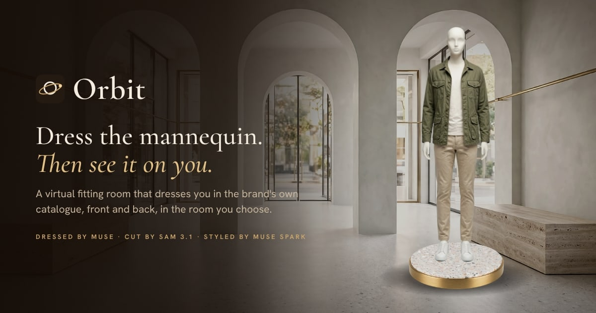
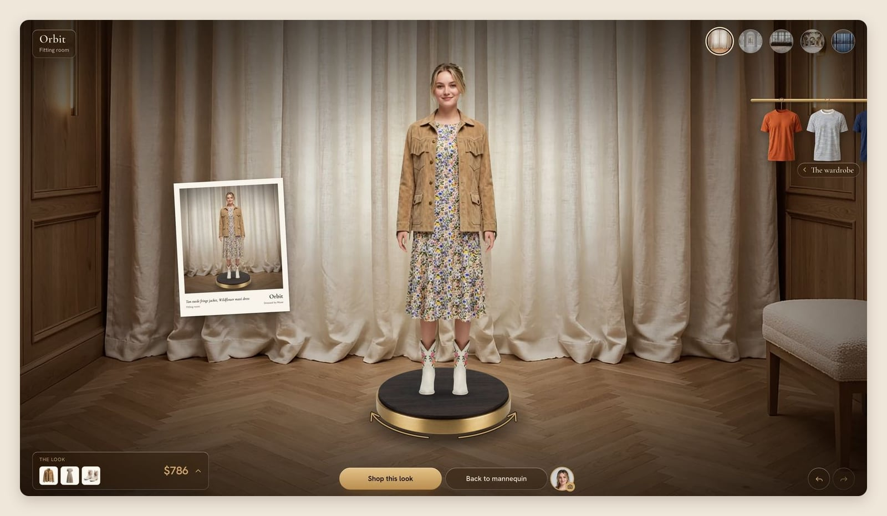
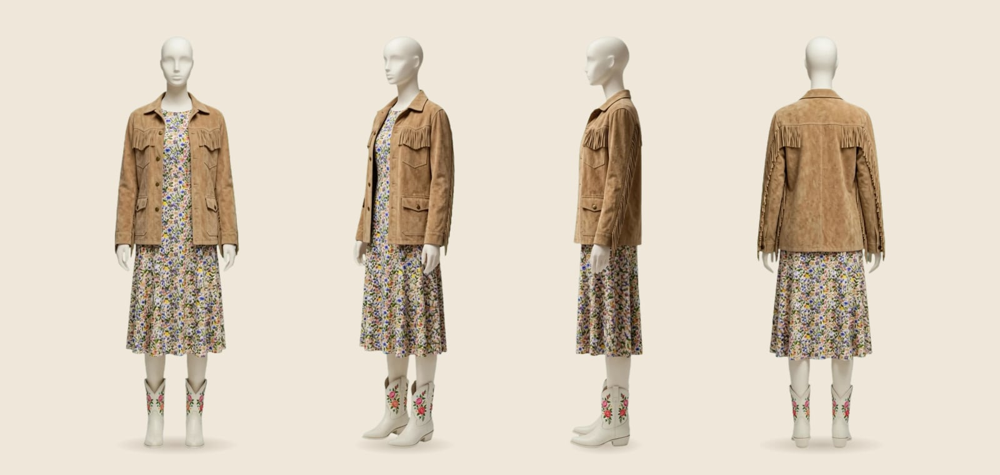
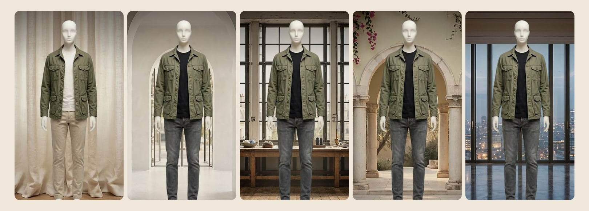
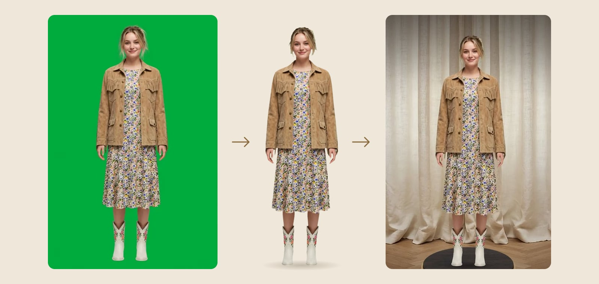
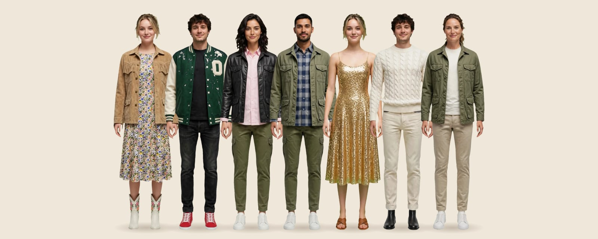
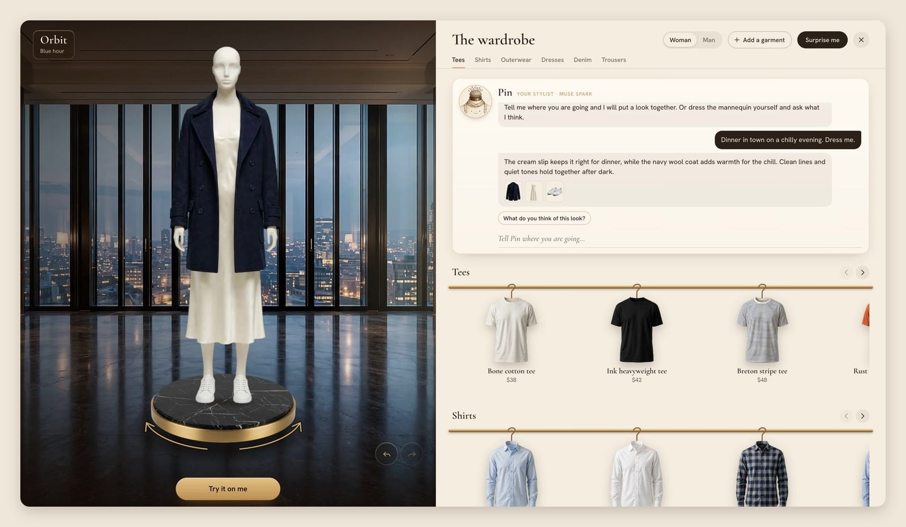
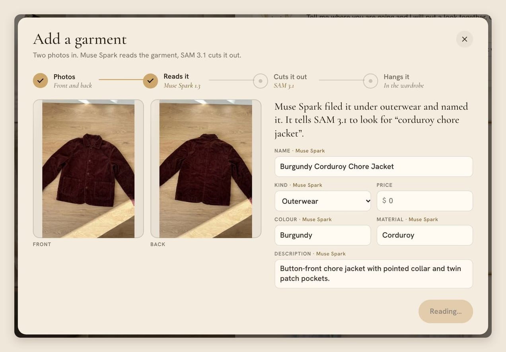

<p align="center">
  
</p>

<p align="center">
  <a href="https://github.com/nicopriotto/orbit/actions/workflows/ci.yml"></a>
  <a href="https://github.com/nicopriotto/orbit/actions/workflows/security.yml"></a>
  <a href="LICENSE"></a>
  
</p>

# Orbit

**A fitting room for online fashion stores.** Shoppers dress a mannequin from the store's own catalogue, turn it, walk it through a few rooms, and then see the same outfit on their own body from a single photo. When they like it, the whole look goes to the store's cart.

Online fashion loses a lot of sales because people can't tell how clothes will look on them. Orbit shows them before they buy, and the brand needs nothing more than two photos of each garment.

<p align="center"></p>

## Dress it, turn it, take it anywhere

Pick any pieces from the rail and Muse Image dresses the mannequin in one sheet with four views. The figure turns by hand, and each new combination is paid for once and then served to every shopper for free.

<p align="center"></p>

The same look in five rooms: the fitting room, a boutique, a tailor's atelier, a courtyard and a penthouse at blue hour.

<p align="center"></p>

## Then see it on you

Upload one photo. Muse Image draws you in the outfit on a green screen, front and back. SAM 3.1 finds the person, and the browser cuts them out and puts them on the stand, in the room, where the mannequin was. A Polaroid of the result is drawn in the browser, so the photo never goes back to a server.

<p align="center"></p>

No photo at hand? Try it on Mia or Theo. Everyone below was made with Muse Image; no real person's photo is in this repository.

<p align="center"></p>

## Pin, the stylist

Tell Pin where you're going and it puts the look together from the catalogue, picks the room and says why. Or dress the mannequin yourself and ask Pin what it thinks. Muse Spark speaks for Pin, held by a strict JSON schema to the catalogue's real ids, so it can only pick what the store sells.

<p align="center"></p>

## A new garment, without a photoshoot

The brand adds a garment from two phone photos, front and back, on any background. Muse Spark reads it and fills in the catalogue entry, SAM 3.1 cuts it out, and Muse Image redraws it as a catalogue photo in the house style. Then it's on the rail, ready to dress the mannequin.

<p align="center"></p>

## Built on Meta's models

| Model | What it does in Orbit |
| --- | --- |
| **Muse Image** `muse-image-1.0` | Dresses the mannequin in four views, puts the shopper in the outfit front and back, redraws a brand's garment as a catalogue photo, and made every garment, room and sample person. |
| **Muse Spark** `muse-spark-1.3` | Reads a new garment into the catalogue, and speaks for Pin. |
| **SAM 3.1** `sam-3.1` | Cuts the brand's garment out of its photo, and finds the shopper in Muse's image. |

Every billed call is logged with its cost, and each endpoint is capped per day and per visitor. Read [docs/HOW-IT-WORKS.md](docs/HOW-IT-WORKS.md) for the details.

## Try it

**[Open the studio](https://nicopriotto.github.io/orbit/)**, no install. That copy has no API key, so it plays what Muse already made: every saved look, and Mia and Theo in them. Pick a combination nobody has made yet and Pin hands you a few that are ready.

To run it yourself:

```bash
npm install
npm run dev        # http://localhost:5192
```

Without a key it works like the hosted copy: 60 garments, the saved looks, and Mia and Theo in them, with nothing billed. To dress new combinations, talk to Pin, add a garment or try a look on your own photo, `cp .env.example .env.local` and set `META_API_KEY`; the page notices the key by itself. `npm run build` also writes what was already made into `dist/demo/`, so `dist` works as a static site. Docker works too: `docker build -t orbit . && docker run -p 5192:5192 --env-file .env.local orbit`.

`npm run check` runs lint, unit tests and the build; `npm run test:e2e` walks the studio in Chromium on desktop and phone, blocking every request that would bill Muse. CI runs both on every push, along with a gitleaks secret scan, CodeQL and `npm audit`. A `v*` tag publishes a Docker image to GHCR. See [CONTRIBUTING.md](CONTRIBUTING.md).

## Honest notes

- The figure doesn't really rotate: it swaps between four views. A try-on shows front and back only.
- The brand, the base catalogue and its prices are invented. `Shop this look` opens a simulated store; set `VITE_STORE_URL` to send the cart to a real one.
- Built from scratch during the Meta AI Developer Hackathon.

## Third-party

Fonts: Cormorant Garamond and Hanken Grotesk (Google Fonts). Libraries: Vite, sharp, and Meta's `@meta-sam/parser` (SAM License). The demo video uses "Werq" by Kevin MacLeod (incompetech.com), licensed under [CC BY 4.0](https://creativecommons.org/licenses/by/4.0/). Code under the [MIT License](LICENSE).
